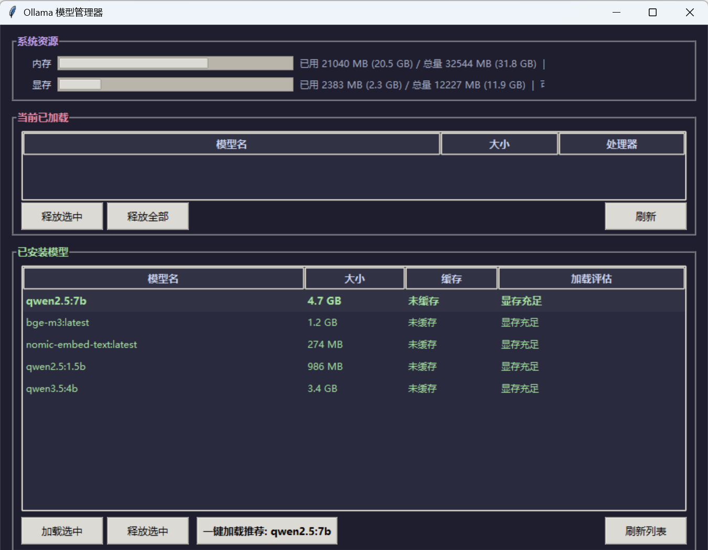

# Ollama 模型管理器

> 小工具性质，不保证跟进 Ollama 新版本；有问题欢迎开 issue。

基于 tkinter 的 Ollama 本地模型管理工具，可查看已安装模型、显存/内存占用、一键加载/释放。

A tkinter desktop tool for Windows: preview the GPU / CPU impact before loading a local Ollama model, load the best fit for your hardware, and verify it actually shows up in `ollama ps`.

## 环境要求

- Windows 系统
- Python 3.8+
- 已安装 [Ollama](https://ollama.com)
- NVIDIA GPU（可选，无 GPU 时显存栏为空）
- `psutil` 库

## 使用方式

1. 安装依赖：`pip install -r requirements.txt`
2. 双击 `启动.bat` 运行

## 功能

- 实时显示系统内存和显存占用
- 列出已缓存的模型和所有已安装模型
- 选中模型预览加载后的资源占用
- 一键加载推荐模型（根据当前可用资源自动推荐）
- 加载后自动验证模型是否成功进入 ollama ps
- 释放选中 / 释放全部模型
- 3 秒自动刷新
